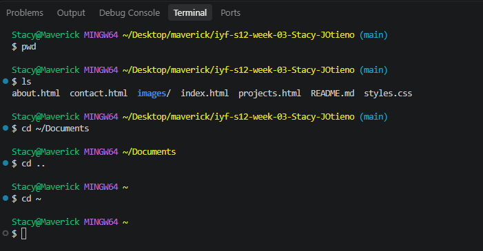

# Week {3}: {Tools & Workflow (Command Line & Git Mastery)}

## Author
- **Name:** Stacy Otieno
- **GitHub:** [@Stacy-JOtieno](https://github.com/Stacy-JOtieno)
- **Date:** November 4, 2026

## Contact
- **Email:** [jjaqkuxi@gmail.com]

## Project Description
The project focuses on developing practical skills in managing web development projects, organizing files and directories, using Git and GitHub for version control, and collaborating with other developers.
The purpose of this project is to demonstrate my ability to manage a development environment, automate repetitive tasks using shell scripts, and apply professional Git and GitHub workflows.

## Technologies Used
- HTML5
- CSS3
- JavaScript|
- Git and Github

## Features
- Multi-page website structure.
- Responsive web design.
- Semantic HTML5 structure.
- CSS styling and layout.
- Flexbox and CSS Grid layouts.
- Navigation between website pages.
- Accessible HTML elements.

## Project Structure
iyf-s12-week-03-Stacy-JOtieno/
├──images
├── my-project/
   └── archive
   └── docs/
      └── about.html
      └── backup.html
      └── contact.html
      └── projects.html
   └── src/
      └── css/
         └── styles.css
      └── images/
         └── blood and glucose monitor.png
         └── gas leak detection system.png
         └── intelligent water-level controller.png
      └── js
   └── tests
   └── README.md
├──.gitignore 
├── basic navigation.png
├── collaboration-test.md
├── new-project.md
├── README.md
├── task-5.3-answers.md
└── terminal-log.md

## How to Run
1. Clone this repository
`git clone https://github.com/Stacy-JOtieno/iyf-s12-week-03-Stacy-JOtieno.git`

2. Navigate into the project directory:
`cd iyf-s12-week-03-Stacy-JOtieno`

3. Open the project in Visual Studio Code:
`code .`

4. Navigate to the my-project/docs/ folder to access the HTML pages.

5. Open the HTML files in your browser to view them.

## Lessons Learned
- Creating and managing Git repositories.
- Using Git commands to track project changes.
- Creating branches and managing commits.
- Pushing and pulling changes between local and remote repositories.
- Collaborating with other developers using GitHub.
- Creating and reviewing pull requests.
- Resolving merge conflicts.
- Using shell scripts to automate project setup.
- Organizing files and folders in a web development project.
- Writing professional project documentation using Markdown.

## Future Improvements
- Add JavaScript interactivity.
- Implement dark mode.
- Improve website animations.
- Enhance mobile responsiveness.
- Add more projects to the portfolio.
- Improve accessibility and SEO.
- Deploy the website using GitHub Pages.

## Challenges Faced
1. I initially experienced difficulties understanding the difference between cloning a repository and creating a new folder. I learned how to navigate directories and manage nested folders correctly.

2. I experienced challenges switching between the master and main branches. I learned how to check my current branch and manage branch names using Git commands.

3. I encountered difficulties when pushing local changes to GitHub. I learned how to check repository status, stage changes, commit updates, and synchronize my local repository with the remote repository.

4. I learned that merge conflicts occur when different changes affect the same parts of a file. The firs merge conflict did not happen because it did not create a merge conflict. But the second time I was able to create a merge conflict and I also was able to resolve the conflict.

5. I initially struggled with navigating between directories and executing commands in the correct project folder. I improved by practising commands such as cd, ls, mkdir, and pwd.

## Collaboration (required in Weeks 0, 3 and 7; omit on other solo weeks)
- **Team / partner:** [@partner](https://github.com/partner)
- **Shared repo:** https://github.com/...
- **PR I opened:** https://github.com/.../pull/N
- **PR I reviewed:** https://github.com/.../pull/N
- **Merge conflict I resolved** (Weeks 0 and 3): https://github.com/.../pull/N
(Collaboration happens outside this repository. It is marked **only** from these links — the marker does not search the shared repo for your work. Every link must point to something authored by your own GitHub account.)

## Screenshots (optional)

## Live Demo (if deployed)
[View Live Demo](https://your-deployed-url.com)

## License
This project is created as a learning exercise to learn about git commands.
